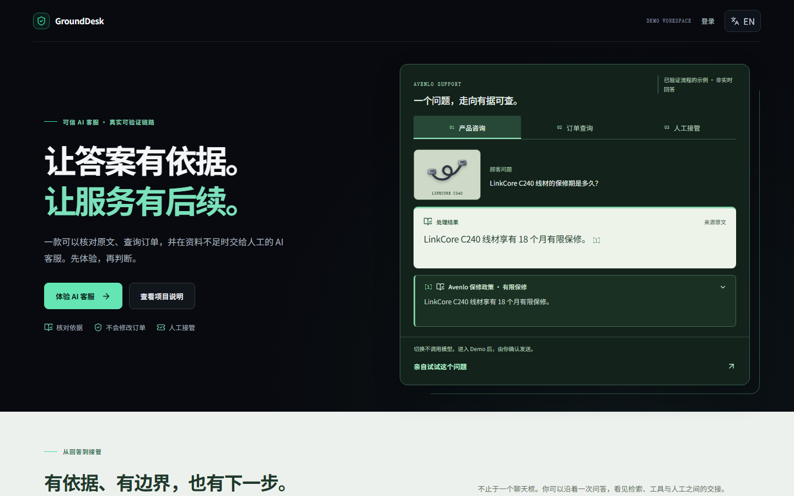
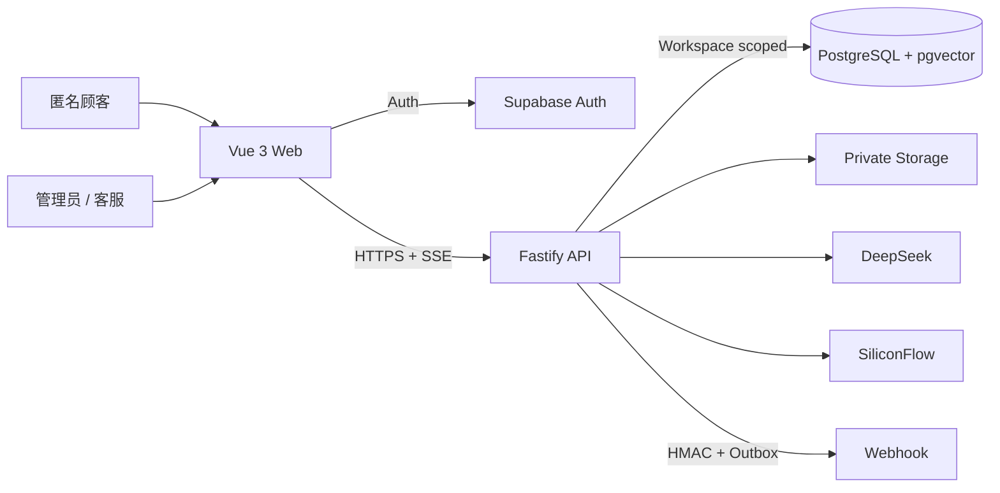
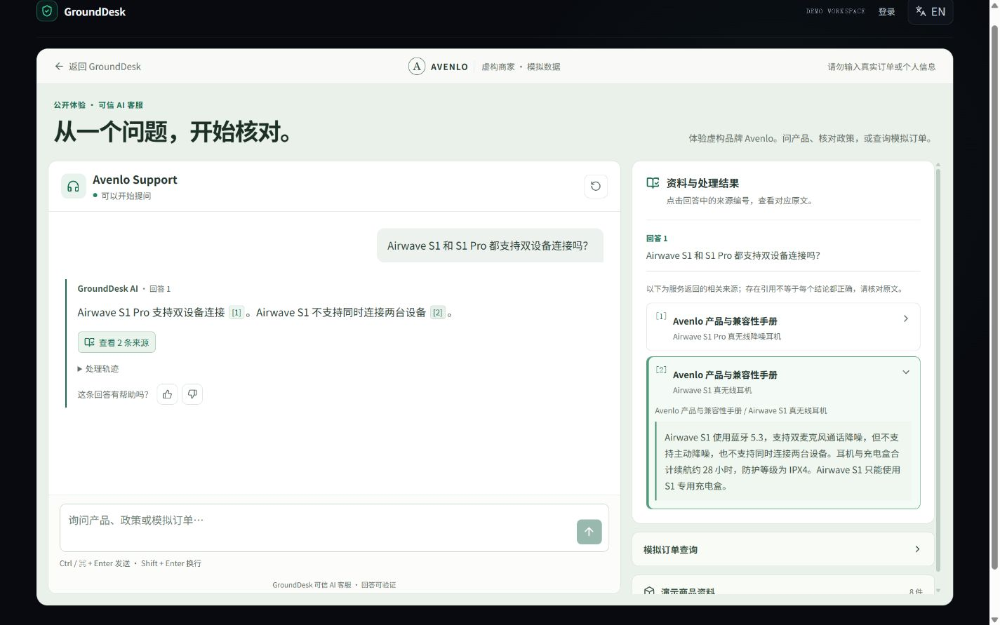
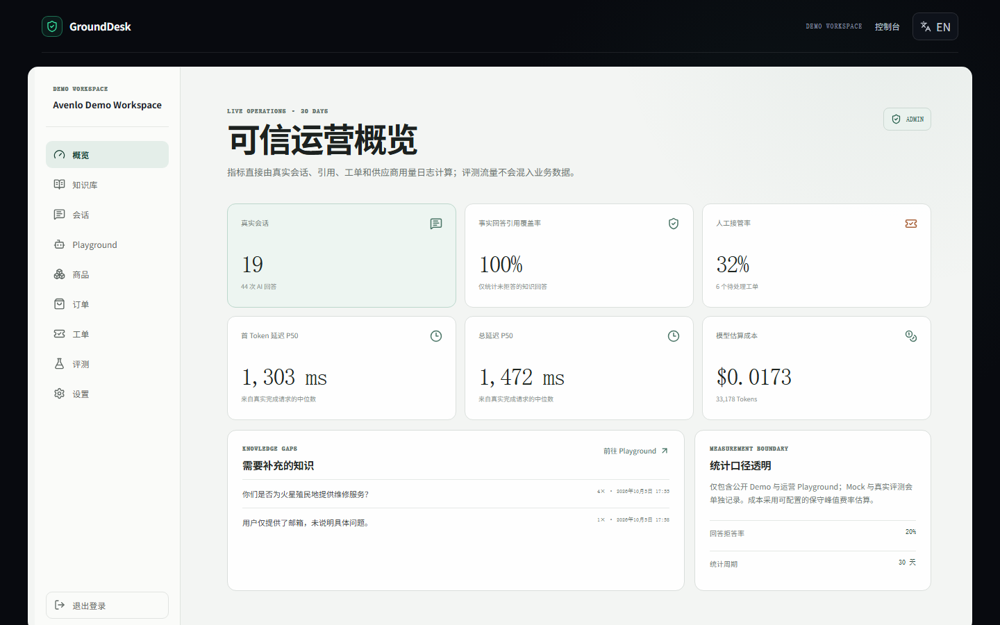
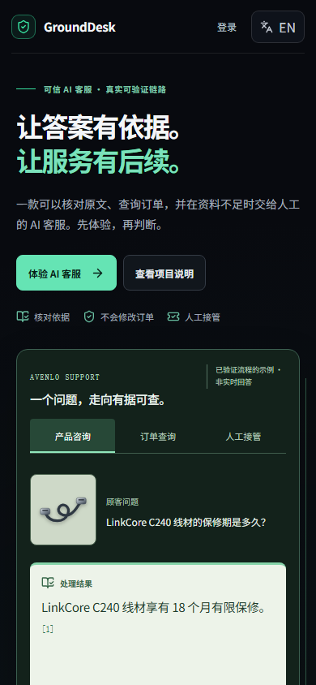

# GroundDesk

> 每一次回答，都有依据。Support answers you can verify.

GroundDesk 是一个面向电商、SaaS 与教育等场景的双语可信 AI 客服知识库 SaaS。它把“模型会回答”约束为“答案有来源、无依据会拒答、业务动作有确定边界”。真实运行模式连接 Supabase、DeepSeek 与 SiliconFlow；仓库不会使用伪造指标或虚构客户评价。

## 在线 Demo

- 公开地址：[https://grounddesk-ai-lsc.onrender.com](https://grounddesk-ai-lsc.onrender.com)；
- Demo Workspace：虚构消费电子品牌 Avenlo，所有商品、订单与顾客均为模拟数据；
- 访客无需填写 API Key，可体验知识引用、订单查询和人工接管；免费托管和外部服务可用性说明见下文；
- GitHub：[lsc-261013/grounddesk-ai](https://github.com/lsc-261013/grounddesk-ai)。

演示账号是公开测试资料，不用于真实业务：

- 管理员：`admin@demo.grounddesk.app`
- 客服：`agent@demo.grounddesk.app`
- 公共 Demo 密码：`GroundDesk!Demo2026`

GitHub 源码和公开站点可能处于不同版本；更新仓库不等于完成线上验收。本文最新改版的验证与截图来自 **2026-10-06 本地版本**，公开地址和历史线上报告单独保留，不将历史结果当成此次改版的新成绩。

本次发布状态与线上验收范围见 [2026-10-06 发布记录](docs/release-2026-10-06.md)；部署尚未验证的项目不会标为通过。

## 当前体验

- 首页用产品咨询、订单查询、人工接管三个场景展示服务边界。每次点击场景按钮都会播放对应流程，再点当前场景也会重播；无独立重播按钮。示例明确为非实时，切换不消耗模型请求。
- 公开问答采用问答与资料双栏，正文编号和总来源入口关联同一条回答；手机可切换资料视图，返回后保留草稿与焦点。工具结果、无来源、等待、失败和转人工状态分别呈现。
- 订单查询保留订单号与邮箱匹配、同会话补齐和只读边界；登录区分凭据、认证连接、工作区连接与权限错误，不把连接失败提示成密码错误。
- 沿用 Vue 3、Node.js 和现有 RAG/Agent 架构；没有改用 React、重建后台、引入动画框架或新增付费资源。



## 核心价值

- **有依据：** PDF、Markdown、TXT 经真实 Embedding 与混合检索进入证据链，事实回答带文档、章节/页码与原文引用；
- **会拒绝：** 无证据、低相似度、政策冲突、提示注入、工具失败或明确要真人时，不允许模型自由编造；
- **能办事但不越权：** Agent 只能选择白名单订单/退货工具，服务端重新校验参数、权限与业务规则；
- **可运营：** 管理员管理知识、商品、订单、成员、Webhook 和评测，客服处理分配工单；
- **可验证：** 每次问答记录检索、引用、工具、延迟、Token、成本、反馈与错误，指标来自数据库真实记录。

## 已实现与验证

| 领域         | 当前实现与验证证据                                                                                                                                         |
| ------------ | ---------------------------------------------------------------------------------------------------------------------------------------------------------- |
| 数据与身份   | 真实 Supabase PostgreSQL、Auth、Private Storage 和 pgvector；管理员、客服及跨 Workspace 权限均通过真实 Smoke Test，26 张业务表启用 RLS。                   |
| 知识库与 RAG | PDF、Markdown、TXT 上传后执行 Hash 去重、结构化切块和真实 BGE-M3 Embedding；使用向量与 PostgreSQL 全文检索融合，回答前执行证据阈值、冲突和引用完整性校验。 |
| Agent 与工具 | DeepSeek 单 Agent 只允许知识问答、订单查询、退货资格和人工接管四种意图；订单工具只读且验证邮箱，退货资格由版本化确定性规则计算。                           |
| 运营闭环     | 提供会话、商品、订单、知识文档、人工工单、Webhook Outbox、用量与质量看板；Demo Reset 可恢复 8 件商品和 30 个模拟订单。                                     |
| 评测与安全   | 26 条双语确定性用例覆盖引用、检索、工具、拒答、提示注入和 Workspace 隔离；公开聊天具备限流、日额度、日志脱敏和 Prompt Injection 防护。                     |
| 交付质量     | TypeScript strict、Vitest/Fastify 集成测试、Playwright E2E、四档响应式和 reduced motion；最新本地检查与历史线上验收分别记录，详见下文。                    |

## 本地启动

首次 Clone 后在项目根目录配置；已有 `.env` 时不要覆盖：

```powershell
pnpm install --frozen-lockfile
Copy-Item .env.example .env
pnpm dev
```

离线模式不需要外部密钥，可启动 Web 与 API 骨架。真实 RAG、登录和公开 Demo 必须切换为 `RUNTIME_MODE=connected`，并在服务端配置 Supabase、DeepSeek 与 SiliconFlow 环境变量。

默认地址：Web `http://localhost:5173`，API `http://localhost:8787`，健康检查 `http://localhost:8787/health`。使用项目 `engines` 支持的 Node.js 和 `packageManager` 声明的 pnpm 版本。

Windows 上若浏览器能认证、但本地 Node 无法连接 Supabase，可采用已经启用的本机 HTTP 代理，仅作用于 API 进程树：

```powershell
# Two repository-root terminals; do not start another API if port 8787 is occupied.
powershell -NoProfile -File .\scripts\dev-api-with-system-proxy.ps1
pnpm dev:web
```

可选脚本要求 Node 22.21+ 或 24.5+，只读取已启用的 loopback 代理，不安装代理、不改系统设置、不关闭 TLS 校验；正常直连环境不需要它。登录成功仍须经过 API 的身份、角色和 Workspace 校验。更多诊断步骤见 [部署与排障](docs/deployment.md)。

## 技术栈

| 层级    | 实现                                                                                 |
| ------- | ------------------------------------------------------------------------------------ |
| Web     | Vue 3、Composition API、TypeScript strict、Vite、Vue Router、Pinia、Vue I18n、Lucide |
| API     | Node.js、Fastify、Zod、SSE、Provider Adapter、显式 Agent 状态机                      |
| Data    | Supabase PostgreSQL、Auth、Private Storage、pgvector、RLS                            |
| AI      | DeepSeek Generation / Tool Calling、SiliconFlow `BAAI/bge-m3` Embedding              |
| Quality | Vitest、Fastify Inject、Playwright、ESLint、Prettier、真实 Provider Smoke Test       |
| Hosting | Render Static Site/Web Service、Supabase Data/Auth/Storage                           |

## 架构概览



浏览器只持有公开 Supabase Publishable Key。所有核心业务通过 Node API；Fastify JWT/权限校验与 Supabase RLS 共同保护 Workspace 数据。详细边界见 [系统架构](docs/architecture.md)、[RAG 数据流](docs/rag-pipeline.md) 和 [Agent 工作流](docs/agent-workflow.md)。

## 环境变量

以 `.env.example` 为唯一模板。不要提交 `.env`。

| 类别       | 关键变量                                                                                                                             | 暴露范围                        |
| ---------- | ------------------------------------------------------------------------------------------------------------------------------------ | ------------------------------- |
| 运行       | `RUNTIME_MODE`、`API_HOST`、`API_PORT`、`WEB_ORIGIN`                                                                                 | API                             |
| Supabase   | `SUPABASE_URL`、`SUPABASE_PUBLISHABLE_KEY`、`SUPABASE_SECRET_KEY`、`SUPABASE_DB_URL`                                                 | API；Secret/DB URL 禁止进入 Web |
| Generation | `DEEPSEEK_API_KEY`、Base URL、模型、超时、成本费率                                                                                   | API                             |
| Embedding  | `SILICONFLOW_API_KEY`、Base URL、模型、维度、超时                                                                                    | API                             |
| Demo 安全  | 请求/Token 日额度、IP/Session 限流、上传与 Chunk 限制                                                                                | API                             |
| Web        | `VITE_API_BASE_URL`、`VITE_SUPABASE_URL`、`VITE_SUPABASE_PUBLISHABLE_KEY`、`VITE_GITHUB_URL`、`VITE_AUTHOR_NAME`、`VITE_CONTACT_URL` | 会进入浏览器构建，只允许公开值  |

`SUPABASE_DB_URL` 是完整 PostgreSQL URI，不是数据库密码；密码中的 URL 保留字符要百分号编码。`VITE_SUPABASE_*` 复用同一 Project URL 与 Publishable Key，不是另一套凭据。

数据库迁移与 Demo Seed 使用根目录 `.env` 中仅服务端可见的 `SUPABASE_DB_URL`：

```bash
pnpm db:migrate
pnpm db:seed
pnpm db:verify
```

初始化并验证可重置的 Demo 成员：

```bash
pnpm auth:bootstrap
pnpm auth:smoke
```

初始化、重建并验证真实知识库：

```bash
pnpm knowledge:bootstrap
pnpm knowledge:reindex
pnpm knowledge:smoke
pnpm knowledge:http-smoke
pnpm agent:smoke
```

`knowledge:smoke` 会调用真实 Embedding 与混合检索；`knowledge:http-smoke` 还会验证登录、Workspace 权限、文档列表、切块预览、内容去重和客服写入拒绝。`agent:smoke` 会调用真实 DeepSeek、SiliconFlow 和 Supabase，产生少量 API 用量，并验证四条核心 Agent 路径。

## 测试与质量门禁

```bash
pnpm validate
pnpm test:e2e
```

`pnpm validate` 依次执行 TypeScript、ESLint、单元/集成测试和生产构建。单元与集成测试使用可控 Provider；UI 隔离测试不调用真实模型。完整 E2E 中的实际账号/工作区检查仍需要 connected Supabase 和 API，不能把完整 E2E 描述为离线测试。

最近验证记录（2026-10-06）：

- typecheck、lint、production build 通过；单元/集成 **141/141**（API 103、Web 35、shared 3）。
- 第四轮登录、权限、布局、问答状态与来源相关浏览器检查 **23/23**；随后场景按钮重播调整的相关回归 **14/14**。两组有重合，不能相加成独立覆盖数。
- 管理员和客服实际登录、刷新、退出后路由保护通过；真实 Auth Smoke 验证管理员设置可访问、客服设置 403、两种身份跨 Workspace 403。
- 最新 UI 反馈后未重跑整套真实模型评测、线上验收、Lighthouse 或实体手机检查。前端入口仍有超过 500kB 的构建提示。

只跑页面与来源隔离回归（不会调用真实模型；需配置前端公开 Supabase 变量供客户端初始化）：

```powershell
$env:E2E_BASE_URL = 'http://localhost:5173'
pnpm --filter @grounddesk/web exec playwright test e2e/demo-experience.spec.ts e2e/demo-round-two.spec.ts e2e/demo-round-three.spec.ts e2e/demo-round-four.spec.ts e2e/home-stage-layout.spec.ts
```

真实公开 Demo 验收需显式设置 `E2E_LIVE_AI=true`，会产生少量 DeepSeek 与 SiliconFlow 用量，并创建正常会话/接管记录；`E2E_RESET_DEMO=true` 会清空模拟运营记录，不属于默认检查。

部署后可将 `E2E_BASE_URL` 设置为公开 Web Origin；Playwright 会跳过本地开发服务器，直接对线上站点执行同一套登录、权限、RAG、工具与接管验收。PowerShell 示例：

```powershell
$env:E2E_BASE_URL = 'https://grounddesk-ai-lsc.onrender.com'
$env:E2E_LIVE_AI = 'true'
pnpm test:e2e
```

历史线上性能报告（**2026-09-01 版本，非此次改版成绩**）：Lighthouse 13 桌面 Performance / Accessibility / Best Practices / SEO 为 99 / 100 / 100 / 100，移动为 98 / 100 / 100 / 100。桌面 FCP/LCP 0.7 秒、TBT 0 ms、CLS 0.00008；移动 FCP/LCP 1.9 秒、TBT 40 ms、CLS 0。详见 [部署手册](docs/deployment.md)。

真实服务专项检查：

```bash
pnpm env:check
pnpm db:verify
pnpm auth:smoke
pnpm knowledge:smoke
pnpm agent:smoke
pnpm tickets:smoke
pnpm eval:live
pnpm eval:report
```

## 真实评测结果

已记录的真实 Provider Run（**2026-08-31 固定样本**）`b2310ecb-6383-4259-9c3b-96bd3f1281c4` 为 26/26：引用覆盖率、Retrieval@5、无答案拒答/接管、工具选择、退货规则和跨 Workspace 隔离达到该 Demo 集门槛。页面从 `eval_runs` / `eval_results` 读取已完成的运行结果，没有写死成绩；此次 UI 更新没有生成新评测成绩。

该结果只代表 26 条固定双语 Demo 用例，不能外推所有行业。项目保留从 21/26 到 26/26 的真实失败与修复过程，见 [评测报告](docs/evaluation-report.md)。

## 部署

仓库已提供：

- `render.yaml`：Render 免费 Static Site 与开发期 Free API、幂等迁移、SPA Rewrite、安全头、平台 `PORT` 和 Secret 声明；
- `vercel.json`：pnpm Monorepo Web 构建、SPA Rewrite、缓存与基础安全头；
- [部署手册](docs/deployment.md)：Supabase、Render、DeepSeek、SiliconFlow、CORS、Auth URL 与无痕验收。

公开环境采用 Render Free API，空闲后可能需要约一分钟唤醒；投递简历前再经项目所有者授权升级。仓库 Blueprint 将自动部署设为提交触发；推送部署所跟踪的分支可能发布新版本，因此不能把“推送 GitHub”与“不影响线上”混为一谈。实际跟踪分支与部署状态以 Render Dashboard 为准，本次没有变更服务套餐或部署配置。

## 安全说明

- 服务端 JWT Claims + Workspace 成员权限 + Repository 条件 + RLS 多层隔离；
- 上传校验扩展名、MIME、签名、大小、空内容和文本编码，私有 Storage 不公开原文；
- Public Chat 同时按 IP 和浏览器 Session 设置独立短时限流，并设置 Workspace 每日请求与 Token 总额度；
- LLM/Embedding 有超时和有限重试，日志对授权头、Cookie、密码、Token 和 Secret 脱敏；
- 工具只允许固定名称和 Zod 参数，数据库查询参数化，订单返回最小化且脱敏；
- Webhook 使用事务型 Outbox、HMAC、AES-256-GCM、超时/重试和 SSRF/DNS Rebinding 防护；
- 知识文档被视为不可信数据，文档中的提示或工具指令不会提升为系统指令；
- Demo 不保存真实支付信息或真实顾客隐私，数据可一键恢复基线。

## 已知限制

- Render Free API 会在空闲后休眠；项目所有者已接受该开发期限制，正式投递简历前应升级为常驻实例以保证首访体验；
- Supabase、生成/Embedding 服务暂停、网络不通或额度不足时，真实登录/问答可能不可用；界面应明确报错，不使用首页示例冒充成功回答；
- PDF 只解析文本层，扫描件需先 OCR；
- 当前未加入 Reranker，混合召回后直接执行证据门禁；
- 只提供通用签名 Webhook，不接 Shopify、WhatsApp、邮件、支付或真实退款；
- 单 Agent 只允许四种意图，不包含多 Agent、微调、语音或长期记忆；
- 26 条评测是项目基线，不代表未经评测的新商家数据；
- 真实 Provider 受网络、额度和供应商波动影响，自动化 CI 默认使用可控 Provider。

## 问答、工作台与手机截图

以下为 2026-10-06 本地运行画面，不是设计稿或此次线上部署证据。问答来自实际 connected 接口与知识引用；工作台来自真实 Supabase 演示身份和数据库。首页舞台是明确标记的非实时流程示例。当前相关布局检查覆盖 1440×900、1280×720、390×844、320px，中英文与 reduced motion 分别验证；不代替实体设备和全站无障碍审计。







[查看场景按钮动效录屏](docs/images/demo-round-four/hero-motion-1440x900.webm) · [本次交互与验证说明](docs/demo-round-four-handoff.md)

## Monorepo

```text
apps/web             Vue 3 用户端、公开 Demo 与商家控制台
apps/api             Fastify API、RAG、Agent、工具与工单服务
packages/shared      跨端 Zod Schema、类型和常量
supabase/migrations  PostgreSQL、pgvector 与 RLS 迁移
supabase/seed        明确标记为模拟数据的 Demo Seed
evals                双语确定性评测集与运行器
docs                 架构、学习、部署与求职材料
scripts              本地验证和维护脚本
```

## 文档索引

- [逐项验收矩阵](docs/acceptance-matrix.md)
- [系统架构](docs/architecture.md)
- [RAG 数据流](docs/rag-pipeline.md)
- [Agent 工作流](docs/agent-workflow.md)
- [真实评测报告](docs/evaluation-report.md)
- [部署手册](docs/deployment.md)
- [三分钟演示脚本](docs/demo-script.md)
- [面试问答](docs/interview-guide.md)
- [简历与开场文案](docs/resume-copy.md)
- [所有者复现清单](docs/owner-checklist.md)
- [英文自由职业服务包](docs/freelance-package.md)
- [持续学习笔记](docs/learning-notes.md)
- [当前交互改版与验证边界](docs/demo-round-four-handoff.md)
- [发布记录与线上验收](docs/release-2026-10-06.md)

## 开源许可

本项目基于 [MIT License](LICENSE) 开源。你可以学习、使用、修改和分发代码，但需要保留原始版权与许可证声明。
