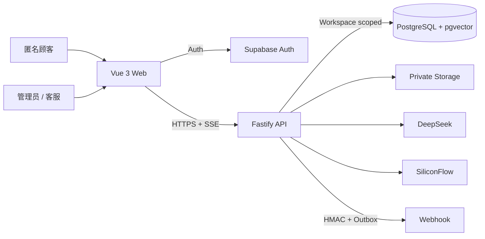
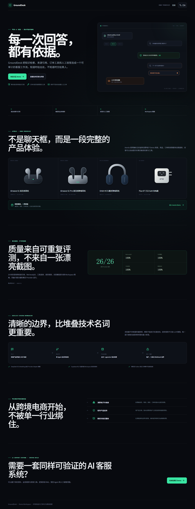
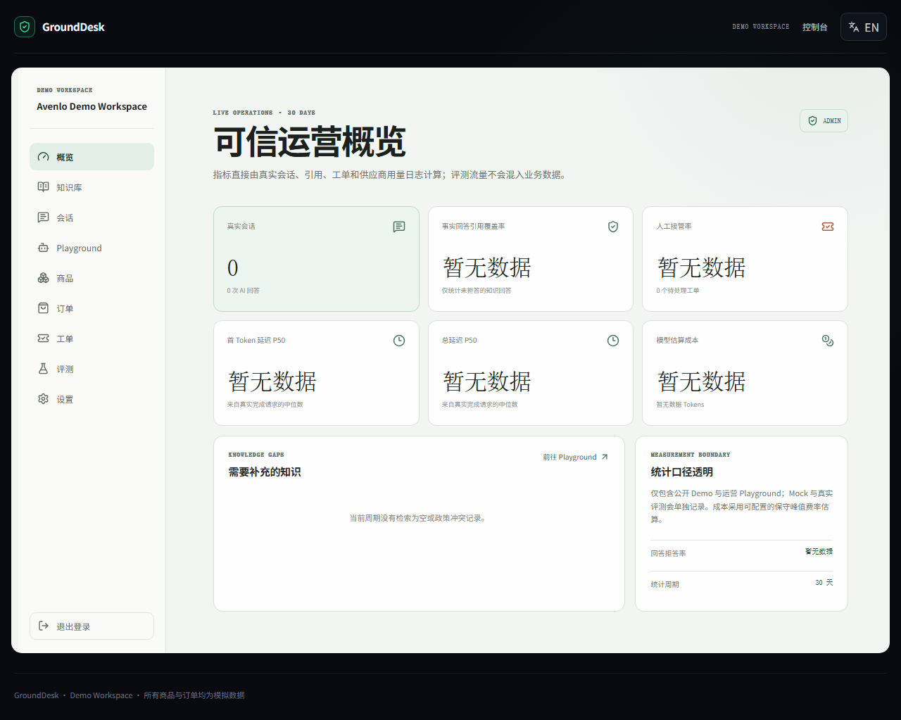
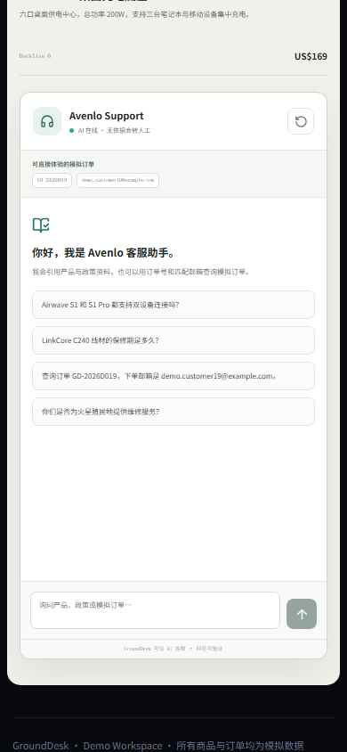

# GroundDesk

> 每一次回答，都有依据。Support answers you can verify.

GroundDesk 是一个面向电商、SaaS 与教育等场景的双语可信 AI 客服知识库 SaaS。它把“模型会回答”约束为“答案有来源、无依据会拒答、业务动作有确定边界”。本地验收截图已经由真实数据库状态录制，公开 Demo 仍待部署验收；仓库不会使用占位 URL、伪造指标或虚构客户评价。

## 在线 Demo

- 公开地址：尚未部署，完成 Vercel 与 Render 验收后填写；
- Demo Workspace：虚构消费电子品牌 Avenlo，所有商品、订单与顾客均为模拟数据；
- 访客无需 API Key；公开部署后可直接体验知识引用、订单查询和人工接管；
- GitHub：由项目所有者确认公开仓库地址后，通过 `VITE_GITHUB_URL` 展示。

## 核心价值

- **有依据：** PDF、Markdown、TXT 经真实 Embedding 与混合检索进入证据链，事实回答带文档、章节/页码与原文引用；
- **会拒绝：** 无证据、低相似度、政策冲突、提示注入、工具失败或明确要真人时，不允许模型自由编造；
- **能办事但不越权：** Agent 只能选择白名单订单/退货工具，服务端重新校验参数、权限与业务规则；
- **可运营：** 管理员管理知识、商品、订单、成员、Webhook 和评测，客服处理分配工单；
- **可验证：** 每次问答记录检索、引用、工具、延迟、Token、成本、反馈与错误，指标来自数据库真实记录。

## 当前状态

里程碑 1 已完成：工程骨架、数据库 Schema、迁移、Demo Seed 与环境校验。迁移已在真实 Supabase 项目执行，重复运行会根据版本和 SHA-256 校验和安全跳过；Seed 重跑后仍保持 8 个商品和 30 个订单。

里程碑 2 已完成：Supabase Auth 真实密码登录、服务端 JWT Claims 校验、管理员/客服角色权限和 Workspace 双重隔离。管理员、客服与跨 Workspace 场景均已通过真实 Supabase Smoke Test；Demo 账号是明确标注、可重置的模拟账号。

里程碑 3 已完成：管理员可上传 PDF、Markdown 和 TXT，系统会执行私有存储、内容去重、页码/章节感知切块、真实 SiliconFlow BGE-M3 Embedding 与 Supabase pgvector + PostgreSQL 全文混合检索。当前真实 Demo 数据包含 4 份双语文档和 26 个 Chunk；三条核心检索 Smoke Case 均命中预期来源。该小样本结果不作为最终评测准确率。

里程碑 4 已完成：DeepSeek 单 Agent 会在四种受控意图中路由，服务端通过真实 SSE 发送处理阶段和回答 Token。知识回答经过相似度阈值、冲突与引用完整性校验；订单工具验证订单号与邮箱并返回脱敏只读结果；退货资格由版本化确定性规则计算。真实 Smoke Test 已通过知识引用、订单工具、退货规则和无答案人工接管四条链路。

里程碑 5 已完成：站内工单支持分配、回复与状态流转；Webhook 使用事务型 Outbox、HMAC、超时、重试和 SSRF 防护；26 条双语确定性评测覆盖知识、订单、退货、无答案、提示注入与跨 Workspace 隔离，最新真实运行 26/26 通过。

里程碑 6 的核心浏览器验收已完成：Playwright 覆盖双语持久化、reduced motion、390px 响应式、管理员保护页刷新、客服角色边界，以及真实订单 Tool Call 和无答案人工接管链路。

管理员商品目录现已连接真实数据库，支持双语主数据、结构化规格、价格、退货属性与公开状态的创建和编辑；商品采用归档而非删除以保留历史订单引用，客服无法修改。Demo Reset 会恢复 8 件基准商品。

## 本地启动

```bash
pnpm install
Copy-Item .env.example .env
pnpm dev
```

离线模式不需要外部密钥，可启动 Web 与 API 骨架。真实 RAG、登录和公开 Demo 必须切换为 `RUNTIME_MODE=connected`，并在服务端配置 Supabase、DeepSeek 与 SiliconFlow 环境变量。

默认地址：Web `http://localhost:5173`，API `http://localhost:8787`，健康检查 `http://localhost:8787/health`。建议使用 Node.js 22 LTS 与项目 `packageManager` 声明的 pnpm 版本。

## 技术栈

| 层级    | 实现                                                                                 |
| ------- | ------------------------------------------------------------------------------------ |
| Web     | Vue 3、Composition API、TypeScript strict、Vite、Vue Router、Pinia、Vue I18n、Lucide |
| API     | Node.js、Fastify、Zod、SSE、Provider Adapter、显式 Agent 状态机                      |
| Data    | Supabase PostgreSQL、Auth、Private Storage、pgvector、RLS                            |
| AI      | DeepSeek Generation / Tool Calling、SiliconFlow `BAAI/bge-m3` Embedding              |
| Quality | Vitest、Fastify Inject、Playwright、ESLint、Prettier、真实 Provider Smoke Test       |
| Hosting | Vercel Web、Render API、Supabase Data/Auth/Storage                                   |

## 架构概览



浏览器只持有公开 Supabase Publishable Key。所有核心业务通过 Node API；Fastify JWT/权限校验与 Supabase RLS 共同保护 Workspace 数据。详细边界见 [系统架构](docs/architecture.md)、[RAG 数据流](docs/rag-pipeline.md) 和 [Agent 工作流](docs/agent-workflow.md)。

## 环境变量

以 `.env.example` 为唯一模板。不要提交 `.env`。

| 类别       | 关键变量                                                                                     | 暴露范围                        |
| ---------- | -------------------------------------------------------------------------------------------- | ------------------------------- |
| 运行       | `RUNTIME_MODE`、`API_HOST`、`API_PORT`、`WEB_ORIGIN`                                         | API                             |
| Supabase   | `SUPABASE_URL`、`SUPABASE_PUBLISHABLE_KEY`、`SUPABASE_SECRET_KEY`、`SUPABASE_DB_URL`         | API；Secret/DB URL 禁止进入 Web |
| Generation | `DEEPSEEK_API_KEY`、Base URL、模型、超时、成本费率                                           | API                             |
| Embedding  | `SILICONFLOW_API_KEY`、Base URL、模型、维度、超时                                            | API                             |
| Demo 安全  | 请求/Token 日额度、IP/Session 限流、上传与 Chunk 限制                                        | API                             |
| Web        | `VITE_API_BASE_URL`、`VITE_SUPABASE_URL`、`VITE_SUPABASE_PUBLISHABLE_KEY`、`VITE_GITHUB_URL` | 会进入浏览器构建，只允许公开值  |

`SUPABASE_DB_URL` 是完整 PostgreSQL URI，不是数据库密码；密码中的 URL 保留字符要百分号编码。`VITE_SUPABASE_*` 复用同一 Project URL 与 Publishable Key，不是另一套凭据。

数据库迁移与 Demo Seed 使用根目录 `.env` 中仅服务端可见的 `SUPABASE_DB_URL`：

```bash
pnpm db:migrate
pnpm db:seed
pnpm db:verify
```

初始化并验证可重置的 Demo 成员：

```bash
pnpm auth:bootstrap
pnpm auth:smoke
```

初始化、重建并验证真实知识库：

```bash
pnpm knowledge:bootstrap
pnpm knowledge:reindex
pnpm knowledge:smoke
pnpm knowledge:http-smoke
pnpm agent:smoke
```

`knowledge:smoke` 会调用真实 Embedding 与混合检索；`knowledge:http-smoke` 还会验证登录、Workspace 权限、文档列表、切块预览、内容去重和客服写入拒绝。`agent:smoke` 会调用真实 DeepSeek、SiliconFlow 和 Supabase，产生少量 API 用量，并验证四条核心 Agent 路径。

## 测试与质量门禁

```bash
pnpm validate
pnpm test:e2e
```

`pnpm validate` 依次执行 TypeScript、ESLint、单元/集成测试和生产构建。默认 E2E 不依赖外部模型；需要验证真实公开 Demo 时，在本地设置 `E2E_LIVE_AI=true` 后单独运行 live public demo 用例，该用例会产生少量 DeepSeek 与 SiliconFlow 用量。

2026-08-31 本地 production build 的 Lighthouse 13 结果：桌面端 Performance 94 / Accessibility 95 / Best Practices 96 / SEO 91；移动端为 97 / 95 / 96 / 91。公开部署后必须从无痕环境重跑，不能把本地网络结果直接当作线上成绩。

真实服务专项检查：

```bash
pnpm env:check
pnpm db:verify
pnpm auth:smoke
pnpm knowledge:smoke
pnpm agent:smoke
pnpm tickets:smoke
pnpm eval:live
pnpm eval:report
```

## 真实评测结果

截至 2026-08-31，最新真实 Provider Run `b2310ecb-6383-4259-9c3b-96bd3f1281c4` 为 26/26：引用覆盖率、Retrieval@5、无答案拒答/接管、工具选择、退货规则和跨 Workspace 隔离均达到当前 Demo 集门槛。页面从 `eval_runs` / `eval_results` 读取这些结果，没有写死成绩。

该结果只代表 26 条固定双语 Demo 用例，不能外推所有行业。项目保留从 21/26 到 26/26 的真实失败与修复过程，见 [评测报告](docs/evaluation-report.md)。

## 部署

仓库已提供：

- `render.yaml`：API 构建、幂等迁移、健康检查、平台 `PORT` 和 Secret 声明；
- `vercel.json`：pnpm Monorepo Web 构建、SPA Rewrite、缓存与基础安全头；
- [部署手册](docs/deployment.md)：Supabase、Render、Vercel、DeepSeek、SiliconFlow、CORS、Auth URL 与无痕验收。

创建付费 Render 常驻实例、写入外部平台或公开仓库前必须由项目所有者明确授权。当前 README 不填写未验证的公开 URL。

## 安全说明

- 服务端 JWT Claims + Workspace 成员权限 + Repository 条件 + RLS 多层隔离；
- 上传校验扩展名、MIME、签名、大小、空内容和文本编码，私有 Storage 不公开原文；
- Public Chat 按 IP/Session 限流并设置每日请求与 Token 额度；
- LLM/Embedding 有超时和有限重试，日志对授权头、Cookie、密码、Token 和 Secret 脱敏；
- 工具只允许固定名称和 Zod 参数，数据库查询参数化，订单返回最小化且脱敏；
- Webhook 使用事务型 Outbox、HMAC、AES-256-GCM、超时/重试和 SSRF/DNS Rebinding 防护；
- 知识文档被视为不可信数据，文档中的提示或工具指令不会提升为系统指令；
- Demo 不保存真实支付信息或真实顾客隐私，数据可一键恢复基线。

## 已知限制

- 尚未完成 Vercel/Render 公开部署与无痕线上验收；当前 Lighthouse 记录仅代表本地 production build；
- PDF 只解析文本层，扫描件需先 OCR；
- 当前未加入 Reranker，混合召回后直接执行证据门禁；
- 只提供通用签名 Webhook，不接 Shopify、WhatsApp、邮件、支付或真实退款；
- 单 Agent 只允许四种意图，不包含多 Agent、微调、语音或长期记忆；
- 26 条评测是项目基线，不代表未经评测的新商家数据；
- 真实 Provider 受网络、额度和供应商波动影响，自动化 CI 默认使用可控 Provider。

## 项目截图

以下截图来自真实本地 API、数据库与最新 Live Evaluation，不是静态设计稿。自动化视觉验收覆盖 1440×900、1280×800、768×1024 和 390×844，并检查每个尺寸没有水平溢出；公开部署后会从无痕环境再次录制核对。





<p align="center">
  
</p>

演示账号是公开测试资料，不用于真实业务：

- 管理员：`admin@demo.grounddesk.app`
- 客服：`agent@demo.grounddesk.app`
- 公共 Demo 密码：`GroundDesk!Demo2026`

## Monorepo

```text
apps/web             Vue 3 用户端、公开 Demo 与商家控制台
apps/api             Fastify API、RAG、Agent、工具与工单服务
packages/shared      跨端 Zod Schema、类型和常量
supabase/migrations  PostgreSQL、pgvector 与 RLS 迁移
supabase/seed        明确标记为模拟数据的 Demo Seed
evals                双语确定性评测集与运行器
docs                 架构、学习、部署与求职材料
scripts              本地验证和维护脚本
```

## 文档索引

- [系统架构](docs/architecture.md)
- [RAG 数据流](docs/rag-pipeline.md)
- [Agent 工作流](docs/agent-workflow.md)
- [真实评测报告](docs/evaluation-report.md)
- [部署手册](docs/deployment.md)
- [三分钟演示脚本](docs/demo-script.md)
- [面试问答](docs/interview-guide.md)
- [简历与开场文案](docs/resume-copy.md)
- [所有者复现清单](docs/owner-checklist.md)
- [英文自由职业服务包](docs/freelance-package.md)
- [持续学习笔记](docs/learning-notes.md)
