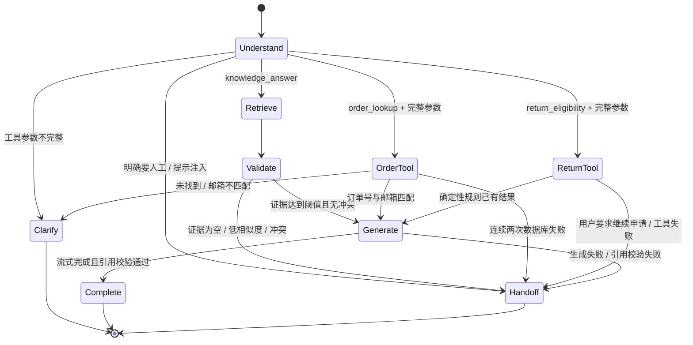

# GroundDesk 单 Agent 工作流

## 状态机与边界

GroundDesk 只允许四种意图，不实现多 Agent：`knowledge_answer`、`order_lookup`、`return_eligibility`、`human_handoff`。DeepSeek 负责选择意图和白名单工具；服务端始终重新校验工具名与 Zod 参数，模型无法拼接 SQL、选择任意函数或直接修改订单。

## 可观察事件

公共 API 使用 POST + SSE，事件依次包含会话 ID、阶段状态、可见文本 Token、引用、结构化工具摘要和最终状态。前端不使用 `setTimeout` 模拟处理；只有服务端实际进入某一步时才出现对应状态。

- `understanding`：DeepSeek 在允许意图中选择路由；显式人工请求和提示注入在模型调用前拦截。
- `retrieving`：BGE-M3 查询向量与全文检索实际执行。
- `validating`：工作区阈值、冲突和引用边界实际检查。
- `calling_tool`：订单或退货规则工具开始与完成。
- `generating`：DeepSeek 的可见回答 Token 实际到达；`reasoning_content` 永不发送给浏览器。
- `completed / handed_off`：回答落库或人工工单创建完成。

## DeepSeek Provider 适配

Provider 使用 DeepSeek 的 OpenAI 兼容 Chat Completions API，默认 `deepseek-v4-flash`、非思考模式和真实流式输出。当前官方模型说明与工具调用格式见 [Models & Pricing](https://api-docs.deepseek.com/quick_start/pricing/) 和 [Tool Calls](https://api-docs.deepseek.com/guides/tool_calls/)。业务层只依赖 `GenerationProvider` 接口，因此厂商 URL、模型和超时通过环境变量替换。

规划请求允许两个函数定义并使用 `tool_choice: auto`；返回的工具名必须在 allowlist，JSON 参数仍由共享 Zod Schema 校验。实际验证中，JSON Output 与 Tool Calling 同时启用会让模型偏向文本 JSON 分支，因此规划请求遵循官方工具调用方式，不叠加 `response_format`。回答流使用 `stream_options.include_usage`，只消费 `content` 与 usage，忽略隐藏推理内容。

## 知识回答与引用门禁

工作区 `confidence_threshold` 作用于 BGE-M3 余弦相似度，不作用于 RRF 排名分数。候选同时保留向量相似度、全文命中强度和两个排名；超过阈值的相关证据最多进入 5 段。系统会检查同一主题的期限和支持性结论是否冲突。

传给模型的证据用独立边界包裹，并明确视为不可信数据。模型只能使用编号证据，每个包含事实的段落必须带合法 `[n]`。浏览器在对应编号出现在流中后收到引用卡片；流结束时服务端再次校验编号和事实段落。如果格式校验失败，系统在完全相同的证据上进行一次温度为 0 的引用格式修复，并再次执行相同门禁；仍失败时前端收到 `replace_answer`，已有引用同时清空，不合格文本被可靠拒答替换并创建工单。

## 订单查询工具

工具输入只有 `orderNumber` 与 `email`。Repository 使用固定参数化 SQL，先按 Workspace + 订单号查询，再由服务端比较规范化邮箱。结果仅包含订单状态、关键时间、脱敏姓名/邮箱/运单号和商品摘要；不返回地址、原始支付信息或任意数据库字段。

`not_found`、`email_mismatch` 与两次读取都失败分别记录。邮箱不匹配时不返回订单详情。所有审计参数只保存订单号后四位和邮箱 Hash 前缀。

## 退货资格工具

退货工具先复用订单双凭据验证，再读取订单购买时生效的版本化政策。纯函数根据已签收时间、商品可退属性、最终销售类别、密封音频窗口、拆封状态、运输损坏报告期和移动电源陆运标签输出 `eligible`、`ineligible` 或 `manual_review`。

每个结果都带政策版本、原因码、匹配条款和 `requiresApproval: true`。模型只能解释结果，不能退款或修改订单。用户明确要求继续退货时，系统只创建待人工审批工单。

## 拒答与人工接管

以下路径不会自由回答：没有证据、相似度不足、证据冲突、提示注入、显式人工请求、工具连续失败、Provider 失败、引用校验失败。系统保存已检查证据、工具调用 ID、原因、摘要和优先级，并把会话状态设为 `handed_off`。运营会话创建可分派、可回复、可流转的人工工单；评测会话只记录确定性结果，不产生运营工单或 Webhook 副作用。

## 已验证结果

真实 Smoke Test 已通过四条核心链路：带真实引用的知识回答、双凭据订单查询、确定性退货资格、无答案拒答与人工接管。26 条双语确定性评测的最新真实 Provider 运行达到 26/26，历史失败和修复过程保留在 [评测报告](./evaluation-report.md)。
