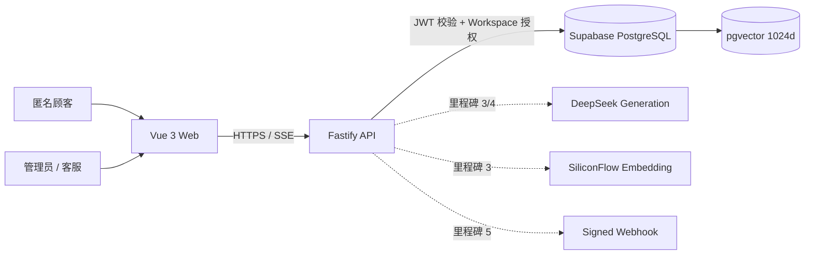

# GroundDesk 系统架构

## 当前边界

GroundDesk 使用 pnpm Monorepo。浏览器只接触公开 API 和 Supabase Publishable Key；所有核心业务、Supabase Secret Key、生成模型与 Embedding Key 都留在 Fastify 服务端。当前里程碑完成了工程与数据边界，尚未声称真实外部服务已经连通。

## 数据隔离

- 业务表带 `workspace_id`；`order_items` 通过订单继承 Workspace。
- RLS 使用 `auth.uid()` 与 `workspace_members` 判断读写权限。
- 管理员拥有关键设置写权限；客服只能读取业务上下文和处理工单。
- 匿名聊天不直接访问数据库，由 API 做限流、会话校验和最小化返回。
- Supabase Secret Key 只存在于服务端；即使服务端使用会绕过 RLS 的高权限连接，Repository 仍必须显式携带 Workspace 条件。

## Embedding 版本边界

`embedding_configs` 把 provider、model、dimensions 与独立 `index_version` 绑定。Chunk 通过 `embedding_config_id` 关联向量版本，检索函数要求传入同一个配置 ID，因此更换模型后不会把新旧向量混在同一检索候选集中。数据库列固定为 `vector(1024)`，环境校验同步要求 1024 维。

## 混合检索基线

数据库函数 `match_hybrid_chunks` 分别计算向量候选与 PostgreSQL 全文候选，再使用 Reciprocal Rank Fusion 合并排名。它只负责候选召回；证据阈值、冲突识别、引用完整性与拒答由后续 RAG 服务层完成。

## 运行模式

- `offline`：无需外部密钥，用于启动 Web/API 骨架与运行确定性测试。
- `connected`：强制要求 Supabase、DeepSeek 和 SiliconFlow 环境变量，供真实 RAG 与公开 Demo 使用。

这两个模式不会让公开 Demo 使用假 AI；离线模式仅用于本地开发和自动化测试。
