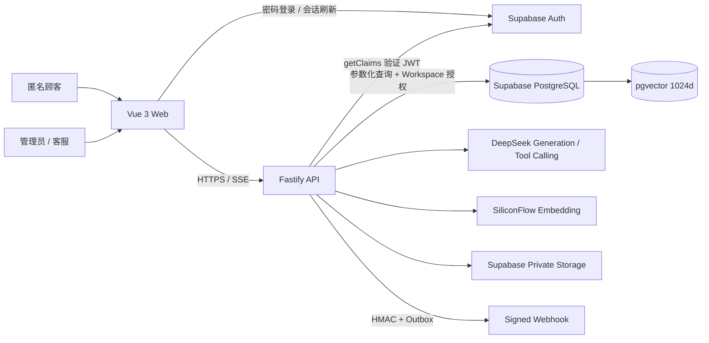

# GroundDesk 系统架构

## 当前边界

GroundDesk 使用 pnpm Monorepo。浏览器只接触公开 API 和 Supabase Publishable Key；所有核心业务、Supabase Secret Key、生成模型与 Embedding Key 都留在 Fastify 服务端。Supabase Schema、Demo Seed、密码登录、JWT Claims 校验、角色边界以及 SiliconFlow Embedding / pgvector 混合检索均已在真实托管项目完成验证；DeepSeek 真实调用会随生成模块执行 Smoke Test。

## 数据隔离

- 业务表带 `workspace_id`；`order_items` 通过订单继承 Workspace。
- RLS 使用 `auth.uid()` 与 `workspace_members` 判断读写权限。
- 管理员拥有关键设置写权限；客服只能读取业务上下文和处理工单。
- 匿名聊天不直接访问数据库，由 API 做限流、会话校验和最小化返回。
- Supabase Secret Key 只存在于服务端；即使服务端使用会绕过 RLS 的高权限连接，Repository 仍必须显式携带 Workspace 条件。

## 身份与授权链路

1. Vue 前端使用 Supabase Publishable Key 完成密码登录和会话刷新。
2. 前端只把短期 Access Token 作为 Bearer Token 发送给 Fastify，不发送数据库密码或 Secret Key。
3. Fastify 通过 Supabase `getClaims(token)` 校验签名、有效期与用户主体。
4. API 使用受控 Repository 查询 `profiles`、`workspace_members` 和 `workspaces`，不信任浏览器声明的角色。
5. 每个 Workspace 路由再次检查成员关系和权限矩阵；未知或未加入的 Workspace 统一返回 403，避免泄露其是否存在。
6. Supabase RLS 作为浏览器 Data API 的第二道隔离边界，服务端授权仍是核心业务入口的第一道边界。

## Embedding 版本边界

`embedding_configs` 把 provider、model、dimensions 与独立 `index_version` 绑定。Chunk 通过 `embedding_config_id` 关联向量版本，检索函数要求传入同一个配置 ID，因此更换模型后不会把新旧向量混在同一检索候选集中。数据库列固定为 `vector(1024)`，环境校验同步要求 1024 维。

## 混合检索基线

数据库函数 `match_hybrid_chunks` 分别计算向量候选与 PostgreSQL 全文候选，再使用 Reciprocal Rank Fusion 合并排名。真实 Demo 数据当前包含 4 份双语文档和 26 个带页码/章节/型号元数据的 Chunk。它只负责候选召回；证据阈值、冲突识别、引用完整性与拒答由后续 RAG 服务层完成。详见 [RAG 数据流](./rag-pipeline.md)。

## 运行模式

- `offline`：无需外部密钥，用于启动 Web/API 骨架与运行确定性测试。
- `connected`：强制要求 Supabase、DeepSeek 和 SiliconFlow 环境变量，供真实 RAG 与公开 Demo 使用。

这两个模式不会让公开 Demo 使用假 AI；离线模式仅用于本地开发和自动化测试。

## 单 Agent 与流式边界

Fastify 通过显式状态机编排四个允许意图，并以 POST + SSE 输出可观察事件。DeepSeek 只能选择白名单工具；参数经 Zod 校验后进入固定 Repository，模型无法执行 SQL。知识回答使用真实 Token 流，隐藏推理内容不会传给浏览器。低置信度、冲突、提示注入、工具失败与引用校验失败统一进入可靠拒答和人工工单。详见 [Agent 工作流](./agent-workflow.md)。

## 工单与 Webhook

人工工单引用原会话、证据 Chunk 和工具调用记录。管理员可查看并分派全部工单；客服 Repository 在 SQL 层只返回分配给当前用户的工单。人工回复和状态更新都重新检查 Workspace 与角色。

Webhook 采用事务型 Outbox：工单插入、状态更新或回复与 `webhook_deliveries` 在同一数据库事务内产生。投递器使用 HMAC-SHA256 签名、超时、指数退避和有限重试；保存和投递前都执行 DNS/IP 检查，禁止环回、私网、保留地址、URL 凭据与生产 HTTP。签名密钥以 AES-256-GCM 加密保存，只在创建时展示一次。

## 运营指标与评测隔离

`conversations.source` 区分 `public_demo`、`playground` 与 `evaluation`。真实评测保留消息、检索和用量审计，但不消耗公开 Demo 日额度、不创建运营工单，也不进入 Overview 指标。Overview 在查询时计算近 30 天会话量、事实回答引用覆盖率、拒答/接管率、延迟 P50、Token 与估算成本，不读取 Seed 指标或页面常量。
