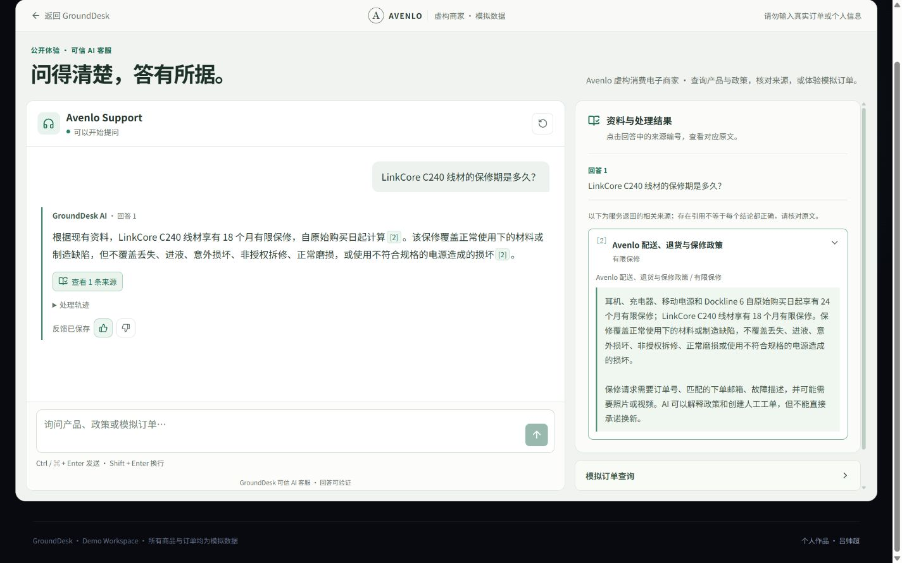
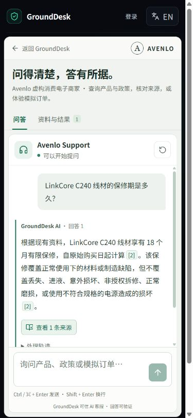

# GroundDesk 公开问答体验优化 · 第一轮交接

## 版本与边界

- 交付版本：`2026-10-05-round-one`；分支 `codex/demo-experience-round-one`。
- 基线：`c4618e85ff1a69f2379fcbe9a47690b94bf935cf`，开始时工作区干净。
- 唯一工作区：`C:\Users\27835\Desktop\grounddesk-ai`。
- 仅改 `/demo` 和直接相关前端组件、状态、样式、翻译、测试与本说明。未重建项目；未改首页、控制台、API 协议、数据库、认证、AI Provider 或部署配置。
- 保留真实资料、工具与接管边界，没有生产假答案、假工单、假指标或新增依赖。未推送、未部署、未购买资源。

## 本地预览

打开 <http://localhost:5173/demo>。本次交付时网页和 API 已启动。

若电脑/终端重启，在项目根目录运行：

```powershell
Set-Location C:\Users\27835\Desktop\grounddesk-ai
pnpm dev
```

网页使用 5173，API 使用 8787；继续读取已有 `.env`，本轮没有修改密钥。需要 Node 22+ 和当前锁文件对应的 pnpm。测试夹具不参与 `pnpm dev`，日常预览仍为 connected 真实链路。

## 修改清单

| 文件                                                 | 职责 / 变化                                                                                   |
| ---------------------------------------------------- | --------------------------------------------------------------------------------------------- |
| `apps/web/src/views/DemoView.vue`                    | 紧凑桌面工作台、手机问答/资料切换、草稿保留、输入法与提交锁、焦点恢复、原问题恢复             |
| `apps/web/src/components/DemoWelcome.vue`            | 四种入口仅填入输入框，不自动调用模型                                                          |
| `apps/web/src/components/DemoChatMessage.vue`        | 正文优先、来源入口、折叠真实轨迹、失败与反馈状态                                              |
| `apps/web/src/components/DemoAnswerText.vue`         | 不使用 v-html 的有限 Markdown 排版、有效引用编号跳转                                          |
| `apps/web/src/components/DemoToolResult.vue`         | 仅展示接口已返回的工具名称、状态、订单字段或退货资格/政策版本                                 |
| `apps/web/src/components/DemoEvidencePanel.vue`      | 对应问题和回答序号、来源章节/页码/原文、已检查来源说明、接管状态前置                          |
| `apps/web/src/composables/useDemoSelection.ts`       | 主动选择后固定旧回答，消息服务端 ID 变更不丢关联                                              |
| `apps/web/src/composables/useDemoScroll.ts`          | 仅靠近底部时跟随；向上阅读时提供新内容提示                                                    |
| `apps/web/src/utils/demoAnswer.ts`                   | 安全链接、段落/列表/加粗解析；脱敏星号保留                                                    |
| `apps/web/src/locales/demoExperience.ts` / `i18n.ts` | 本轮中英文文案；不替换其他页面词条                                                            |
| `apps/web/src/styles/demo.css`                       | Demo 专属样式、响应式、焦点和 reduced motion                                                  |
| `apps/web/src/stores/chat.ts`                        | SSE 错误/提前断开终态，进行中防重置，反馈请求锁与真实保存状态；共享 Playground 也使用此状态层 |
| `apps/web/tests/*demo*` / `chat.test.ts`             | 来源、文本、滚动、协议异常、反馈失败等回归                                                    |
| `apps/web/e2e/demo-experience.spec.ts`               | 独立夹具的 7 项浏览器回归；夹具不写真实数据                                                   |
| `apps/web/e2e/grounddesk.spec.ts`                    | 仅适配 Demo 新入口与工具摘要定位，未改变 Auth 断言                                            |

## 实际检查与修复

采用“实现 → 实际操作与截图 → 找出具体问题 → 修正 → 复查”，不是仅交第一版。

1. 基线首屏说明区过高，输入区落在屏外：压缩为工作台导语，桌面输入区进入首屏；手机采用双视图。
2. 新回复抢走旧来源选择：改用稳定消息对象关联和主动固定，服务端替换消息 ID 后仍保持选择。
3. 流式更新强制跳底：按阅读位置跟随；真实增量 SSE 测试夹具确认向上阅读不跳，显式“回到底部”有效。
4. 关闭原文后再点同一编号不能打开：增加选择版本并回归。
5. 真实订单回复中的脱敏星号被误识别为加粗：收紧格式边界，保留原始脱敏姓名。
6. 手机引用定位带动外层页面：定位改为只滚动资料面板，加入页面 scrollY 不变断言。
7. 人工接管卡被长来源列表挤出视线：将已确认结果前置；拒答来源明确为“已检查但不足”。
8. SSE error / 无 done 提前断开仍留等待态：进入失败终态，保留部分结果，不显示成功接管或可评价的完整回答。
9. 故障恢复可能重复副作用：只恢复原问题，不自动重发；进行中不允许重置或再提交。

引用仅表示服务返回了相关片段，不自动证明每个结论正确。编号缺少对应引用时保留为普通文字，不把工具回复的编号链接到其他回答。原文不做伪造的句子级精准高亮。

## 验证结果

| 检查                                                                             | 结果                                                                            |
| -------------------------------------------------------------------------------- | ------------------------------------------------------------------------------- |
| `pnpm typecheck`                                                                 | 全工作区通过                                                                    |
| `pnpm lint`                                                                      | 全工作区通过                                                                    |
| `pnpm test`                                                                      | 最终全工作区 shared 3、API 81、Web 25 通过，合计 109 |
| `pnpm build`                                                                     | 全工作区 production build 通过                                                  |
| `pnpm --filter @grounddesk/web exec playwright test e2e/demo-experience.spec.ts` | 7/7 通过                                                                        |
| 既有 `grounddesk.spec.ts --grep 'landing page'`                                  | 1/1 通过，首页未修改                                                            |
| 完整 `grounddesk.spec.ts` + 本轮 E2E 的额外运行                                  | 当时 7 通过、2 登录失败、2 显式开关用例跳过；不宣称全 E2E 通过                  |
| `pnpm auth:smoke`                                                                | 未通过：AuthRetryableFetchError / fetch failed / status 0                       |
| `git diff --check`                                                               | 通过                                                                            |

浏览器验证 1440×900、1280×800、390×844：初始输入入口、多轮来源、等待与草稿、长回答、无引用、HTTP 503、SSE error、人工接管真假状态、商品失败/重试、中英文、焦点、输入法组合事件和 reduced motion。独立测试没有水平溢出，首屏可见输入区。流程不使用生产假定时器。

真实连接使用已有配置实际操作：

- 商品 API HTTP 200，8 件；不是测试商品常量。
- LinkCore C240 保修问答经真实链路返回 18 个月，并通过 `[2]` 核对“有限保修”章节原文。
- 用公开演示订单和邮箱查询 GD-2026D019，受控工具确认凭据校验、已签收、Orbit H5。
- 资料外问题真实拒答、服务确认人工工单创建；已转人工会话的新消息不继续自动回答。
- 公开回答反馈实际保存，界面在成功响应后显示“反馈已保存”。

这些真实操作会产生正常会话/工单/反馈记录，未伪造、删除或重置数据。仅核对服务返回的接管标记；没有把工单创建包装成真人已在线。

## 代表截图

`docs/images/demo-round-one/` 中 `live-*` 为实际 connected 本地浏览器，`fixture-*` 为明确隔离的自动化测试状态。文件名记录目标视口；内置浏览器会缩放可见区截图，原图像素可能小于视口，精确 390×844 等像素的 fixture 截图来自 Playwright。

| 截图                                                        | 内容                                |
| ----------------------------------------------------------- | ----------------------------------- |
| `live-initial-1440x900.jpg` / `live-initial-1280x800.jpg`   | 真实初始桌面工作台                  |
| `live-initial-390x844.jpg`                                  | 真实手机入口与输入区                |
| `live-answer-1440x900.jpg`                                  | 真实回答与展开的政策来源            |
| `live-chat-390x844.jpg` / `live-evidence-390x844.jpg`       | 手机回答 / 对应原文                 |
| `live-order-390x844.jpg`                                    | 真实订单工具结构化摘要              |
| `live-handoff-1440x900.jpg` / `live-handoff-390x844.jpg`    | 真实拒答与确认接管                  |
| `fixture-error-390x844.jpg` / `fixture-waiting-390x844.jpg` | 可控异常 / 等待；不是实际供应商结果 |





## 未验证与边界

- 两项控制台登录回归未通过。Node 的 Auth 请求连接失败；另用 PowerShell 请求 `/auth/v1/health` 返回 401，说明该入口可达但未携 key，不能据此推断认证正常或账号密码错误。未改认证或要求用户重新建账号。
- 实体手机软键盘、Safari/Firefox、屏幕阅读器完整验收没有执行；输入法组合事件和键盘交互只在测试 Chromium 验证。
- 没有跑 Lighthouse，也不承诺 WCAG AA 全面认证；检查了布局、焦点和 reduced motion。
- 本轮没有线上部署、线上无痕验收或后端升级；Render 是否休眠不在本次修改中。
- 真实人工回复、退货后审批/退款没有测试；前端不提供退款权限。本轮退货展示只消费已有工具字段，没有新增规则。
- 首次真实订单自然语言回答中，模型把已校验邮箱说成“无法完整核对”；结构化工具显示校验完成。本轮保留原文、不修改模型逻辑，记录为后续 AI 质量事项，不声称已修复。
- 构建有全站主入口约 504 kB 的警告。Demo 独立路由块约 22 kB（gzip 约 7.3 kB）；未为本轮改全站拆包。
- 没有添加停止生成按钮：现有服务不提供可靠的取消副作用保证。原问题恢复由用户决定是否再提交。

## 如何验收与撤回

1. 打开 `/demo`，点击示例：只填问题，不直接发送。
2. 发送保修问题，点击正文编号，对照原文；发送下一条时，主动选过的旧来源不被抢走。
3. 手机切换问答/资料，草稿和会话保留，返回恢复原焦点。
4. 资料外问题检查是否明确拒答、等待人工；不要把工单当作真人即时在线。

本轮在独立分支，仅有本地提交。验收前无需合并。

- 整轮放弃：工作区干净时 `git switch main`，重新运行 `pnpm dev` 即回到原版本。不要删除优化分支，可随时再查看。
- 若验收后合并且想撤回：用 `git revert <本轮提交 SHA>` 生成反向提交，不使用 reset --hard。
- 切换前若有你后来新增的未提交内容，请先另行提交或备份；不要覆盖它们。
- 代码撤回不删除本轮正常真实问答产生的会话、工单和反馈。没有执行数据库重置。

后续只等待用户验收，不自动扩展第二轮、推送或部署。
