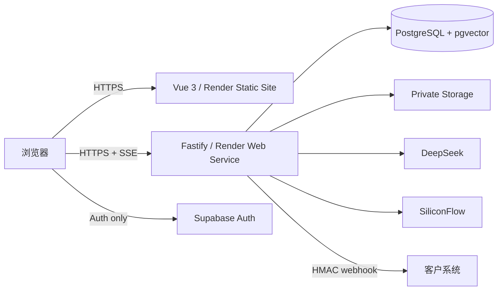

# GroundDesk 部署手册

## 目标拓扑



前端只持有 Supabase Publishable Key。Secret Key、数据库连接串、DeepSeek Key 和 SiliconFlow Key 只配置在 Render。部署不会创建 Render Postgres，因为 GroundDesk 的数据库、Auth、Storage 与 pgvector 统一由 Supabase 托管。

当前已验证环境：

- Web：https://grounddesk-ai-lsc.onrender.com
- API：https://grounddesk-api-lsc.onrender.com
- Health：https://grounddesk-api-lsc.onrender.com/health

以上地址与线上报告来自历史部署记录，不能证明 2026-10-06 的首页/问答改版已上线。本次本地验证和截图见 [当前交互交接](demo-round-four-handoff.md)；后续发布后需要重新做线上检查，不继承历史 Lighthouse 或模型评测数字。

## 1. 部署前门禁

在干净工作区执行：

```bash
corepack enable
pnpm install --frozen-lockfile
pnpm env:check
pnpm validate
pnpm test:e2e
```

`pnpm env:check` 只输出配置状态，不输出密钥。公开环境必须显示 `runtimeMode: connected`，并且 database、generation、embedding 都为 `true`。

2026-08-31 的公开健康检查已满足上述条件。

## 2. Supabase

### 2.1 项目配置

从 Supabase Dashboard 取得：

- Project URL → `SUPABASE_URL` 与 `VITE_SUPABASE_URL`；
- Publishable Key → `SUPABASE_PUBLISHABLE_KEY` 与 `VITE_SUPABASE_PUBLISHABLE_KEY`；
- Secret Key → 仅 `SUPABASE_SECRET_KEY`；
- Connect → PostgreSQL connection string → 仅 `SUPABASE_DB_URL`。

数据库密码不是连接串。连接串包含主机、端口、数据库用户、密码和数据库名；密码中的 `@`、`:`、`/`、`#`、`%` 等保留字符必须进行百分号编码。优先复制 Dashboard 生成的 URI 并只替换其中的密码占位符。

### 2.2 初始化

在根目录 `.env` 完成服务端配置后执行：

```bash
pnpm db:migrate
pnpm db:seed
pnpm db:verify
pnpm auth:bootstrap
pnpm auth:smoke
pnpm knowledge:bootstrap
pnpm knowledge:smoke
```

迁移使用版本号与 SHA-256 校验和，可安全重跑。Seed 使用稳定主键与相对初始化日期，重跑不会把 8 个商品、30 个订单和评测用例重复插入。`knowledge:bootstrap` 会产生真实 Embedding 用量。

### 2.3 Auth URL

部署前在 Supabase Auth → URL Configuration 设置：

- Site URL：最终 Render Static Site URL；
- Redirect URLs：最终 Render Static Site URL 及其 `/login`、`/onboarding` 路径；
- 本地开发保留 `http://localhost:5173/**`。

Demo 管理员和客服由 `pnpm auth:bootstrap` 创建并确认邮箱。普通注册是否要求邮件确认由 Supabase Auth 策略决定；不要为了演示关闭生产项目的安全控制。

2026-09-01 已在生产项目核对：Site URL 为 `https://grounddesk-ai-lsc.onrender.com`，Redirect URL 包含 `https://grounddesk-ai-lsc.onrender.com/**` 与 `http://localhost:5173/**`；公开 Auth 设置中邮箱注册已启用。

## 3. Render API

仓库根目录的 `render.yaml` 定义构建、迁移、启动、健康检查和非敏感默认值。它不会写入任何密钥。根据 [Render Blueprint](https://render.com/docs/blueprint-spec) 创建服务，并在首次导入时填写所有 `sync: false` 项。

必须填写：

| 变量                       | 值                                           |
| -------------------------- | -------------------------------------------- |
| `WEB_ORIGIN`               | 最终 Render Static Site Origin，不带末尾斜杠 |
| `SUPABASE_URL`             | Supabase Project URL                         |
| `SUPABASE_PUBLISHABLE_KEY` | Supabase Publishable Key                     |
| `SUPABASE_SECRET_KEY`      | Supabase Secret Key                          |
| `SUPABASE_DB_URL`          | 已正确编码密码的 PostgreSQL URI              |
| `DEEPSEEK_API_KEY`         | DeepSeek 服务端 Key                          |
| `SILICONFLOW_API_KEY`      | SiliconFlow 服务端 Key                       |

Render 自动提供 `PORT`；API 会优先使用显式 `API_PORT`，否则读取 `PORT`，并绑定 `0.0.0.0`。健康检查路径是 `/health`。

开发联调阶段使用 Render Free Web Service（0.1 CPU / 512 MB）和免费 Static Site，不要求绑定付款方式。Free API 空闲 15 分钟后会休眠，下一次请求可能需要约一分钟唤醒，因此只作为开发期环境；投递简历前再经项目所有者确认升级为常驻实例。Free 实例不支持 Pre-deploy Command，幂等迁移暂时放在 API Build Command 中执行；升级付费实例后应恢复为独立的 Pre-deploy Command。

Render 的 Node 镜像已经提供 pnpm shim，不要在 Build Command 中执行 `corepack enable`。真实首次部署曾因此尝试删除只读的 `/usr/bin/pnpm` 并以 `EROFS` 失败；当前 Blueprint 直接执行 `pnpm install --frozen-lockfile`，修复后 API 与 Static Site 均成功上线。

首次部署后验证：

```text
GET https://<render-host>/health
```

响应应为 `status: ok`、`runtimeMode: connected`，三个 Provider 状态均为已配置。

## 4. Render Static Site

同一份 `render.yaml` 定义 Vue Web 构建、`apps/web/dist` 发布目录、Vue Router SPA Rewrite、安全响应头和长期缓存。通过 Render Blueprint 导入仓库时，API 与 Static Site 一次创建；只有 Supabase 两项前端公开值需要在 Dashboard 填写。

配置 Production 环境变量：

| 变量                            | 值                                       |
| ------------------------------- | ---------------------------------------- |
| `VITE_API_BASE_URL`             | Render API HTTPS Origin，不带末尾斜杠    |
| `VITE_SUPABASE_URL`             | Supabase Project URL                     |
| `VITE_SUPABASE_PUBLISHABLE_KEY` | Supabase Publishable Key                 |
| `VITE_GITHUB_URL`               | 最终公开仓库 URL；未配置时页面隐藏该入口 |
| `VITE_AUTHOR_NAME`              | 落地页与页脚展示的公开作者名             |
| `VITE_CONTACT_URL`              | 公开联系入口，例如作品集或职业邮箱链接   |

`VITE_` 变量会进入前端构建产物，因此只能放公开值。任何 Secret Key、数据库连接串或模型 Key 都不得使用 `VITE_` 前缀。仓库、作者和联系链接已作为非敏感 Blueprint 值提交；API Origin 和 Web CORS Origin 通过 `fromService` 引用 Render 自动注入的 `RENDER_EXTERNAL_URL`，避免硬编码平台子域。

Blueprint 首次分配域名后，核对 API `/health` 和浏览器网络请求使用实际 `onrender.com` Origin。最后回到 Supabase 更新 Site URL / Redirect URLs，完成 Auth 闭环；Blueprint 每次同步都会让两个跨服务 Origin 跟随平台 URL。

## 5. 生产初始化与真实验收

部署环境数据库完成迁移后，仅执行一次 Demo 初始化；后续重置从控制台触发：

```bash
pnpm db:seed
pnpm auth:bootstrap
pnpm knowledge:bootstrap
pnpm eval:live
pnpm eval:report
```

真实评测会产生少量 DeepSeek 与 SiliconFlow 费用。验收顺序：

1. 无痕窗口打开落地页，确认不依赖登录即可看到真实评测；
2. 打开 `/demo`，完成引用问答、订单查询和无答案接管；
3. 用管理员账号登录，检查文档、Chunk、会话、工单和评测；
4. 用客服账号登录，确认看不到设置和商品写入入口，只能处理分配工单；
5. 在 1440×900、1280、768 与 390×844 下检查布局；
6. 运行 Lighthouse，记录 Performance、Accessibility、Best Practices、SEO；
7. 检查前端 Source、网络响应和 Git 历史中不存在密钥。

2026-09-01 最终公网 Lighthouse 13 记录为：桌面 99/100/100/100，移动 98/100/100/100（Performance / Accessibility / Best Practices / SEO）。桌面 FCP/LCP 0.7 秒、TBT 0 ms、CLS 0.00008；移动 FCP/LCP 1.9 秒、TBT 40 ms、CLS 0。提交 `46208b7` 已部署，认证初始化期间页脚提前出现造成的首轮移动 CLS 0.103 已消除。

部署后的浏览器主路径不需要另写临时脚本。把 Playwright 指向公开 Web Origin，即可跳过本地 Dev Server 并复用仓库中的真实验收：

```powershell
$env:E2E_BASE_URL = 'https://your-public-web-origin.example'
$env:E2E_LIVE_AI = 'true'
pnpm test:e2e
```

如需重新录制四视口证据，再设置 `$env:E2E_VISUAL_AUDIT = 'true'`。`E2E_RESET_DEMO` 默认关闭，因为它会清空 Demo 运营记录；仅在确认需要恢复公开演示基线时临时开启。

## 6. 更新、回滚与故障定位

- Render 每次部署前运行 `pnpm db:migrate`；只允许前向、可重复迁移，不在自动流程中运行 Seed。
- Render Static Site 静态资源带内容 Hash，可以回滚到上一成功 Deployment；API 回滚前确认新迁移是否向后兼容。
- `/health` 正常但聊天失败：检查 Provider 状态、Render 出站网络和用量额度。
- 登录成功但 API 返回 401：检查 Supabase 项目是否一致，以及浏览器 Access Token 是否来自同一 Project URL。
- 登录已认证但工作区加载失败：区分 token/成员问题与服务端访问认证服务失败；网络/供应商不可用应返回 503，不提示用户修改密码。
- 浏览器出现 CORS：`WEB_ORIGIN` 必须与地址栏 Origin 完全一致。
- 数据库连接失败：重新复制连接 URI，并检查特殊字符编码、IPv4/Pooler 选择和 Supabase 网络限制。
- 前端刷新子路由 404：确认 Render Static Site 已同步仓库中的 `/* → /index.html` Rewrite。

### 6.1 发布分支与自动部署

`render.yaml` 的两个服务均设置 `autoDeployTrigger: commit`。真正部署哪一条分支由服务/Blueprint 设置决定；推送受跟踪分支可能触发构建与上线。仅备份源码时推送非部署分支；更新主分支前先确认是否授权同时发布，不自行关闭或修改服务的自动部署设置。

本地门禁成功不等于部署成功，也不等于公开 AI 链路已验收。发布后应核对两个服务的 Deployment 状态与提交 SHA，然后从公开入口实际检查登录、问答引用、订单工具和接管。没有实际完成的检查应保留为未验证。

### 6.2 Windows 本地认证连接诊断

2026-10-06 的真实故障发生在浏览器密码认证之后：Supabase 200，GroundDesk session 401；Node 获取公开 JWKS 时 ECONNRESET，而同机器系统 HTTP 请求成功。前后端项目 URL/key 一致，不是公开演示密码过期。用本机已有 loopback 代理对照后 JWKS/claims 和业务会话成功，两种角色及跨 Workspace 边界恢复。

网络能直连时继续 `pnpm dev`。只有本机已启用 loopback HTTP 代理且 Node 需要采用它时，才在两个项目根目录终端分别执行：

```powershell
# Terminal 1
powershell -NoProfile -File .\scripts\dev-api-with-system-proxy.ps1

# Terminal 2
pnpm dev:web
```

该可选脚本需要 Node 22.21+ 或 24.5+，检查 8787 未占用，只为 API 进程树配置现有代理；不写注册表、Git 全局设置或 `.env`，不关闭 TLS 验证，也不把 localhost 代理地址部署到 Render。不要用重置密码、重建账号、关闭 JWT/RLS 来掩盖网络错误。

## 7. 密钥轮换

密钥只写入本地 `.env` 和 Render Secret Environment Variables；Vite 构建变量只允许放 API Origin、Supabase Publishable Key、仓库链接和公开作者资料。发生疑似泄漏时先在供应商侧轮换，再更新 Render，最后检查日志和 Git 历史。Webhook 每个 Endpoint 有独立签名密钥，创建时只显示一次；数据库仅保存由服务端主密钥派生加密键加密后的密文。
