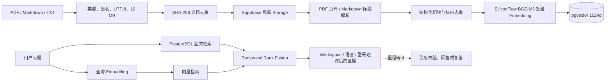

# GroundDesk RAG 数据流

## 已实现链路



## 上传与状态

API 仅接受单个 PDF、Markdown 或 UTF-8 TXT，单文件上限 10 MB，单 Workspace 上限 20 个文档。扩展名、MIME、PDF 文件签名、空内容和二进制文本会同时校验。文件先计算 SHA-256；相同 Workspace 内同一内容再次上传时直接返回原文档，不新增 Storage 对象或 Chunk。

文档状态为 `queued → processing → ready`，解析或外部 Provider 失败时进入 `failed` 并保存面向人的安全错误。后台任务不阻塞上传响应；管理员可查看状态、失败原因并重试。原文件存放在私有 `grounddesk-knowledge` Bucket，浏览器没有读取 Secret Key。

## 解析与结构化切块

- PDF 使用 `unpdf` 提取逐页文本，保留 `page_start/page_end`；无文本的扫描件明确提示需先 OCR。
- Markdown 按标题层级形成 `section_path`；标题变化一定切块，避免两个相似型号跨章节混入同一证据。
- TXT 按段落切分。
- 所有文本统一换行和空白；Chunk 使用内容 Hash 去重并保留语言、商品型号、来源和近似 Token 数。
- 默认目标长度 1,200 字符、重叠 180 字符，可由服务端环境变量调整。章节边界不继承重叠，防止不同政策或型号串段。

## Embedding 版本边界

SiliconFlow Provider 通过独立适配器调用 `BAAI/bge-m3`，校验每个向量必须为 1,024 维，并执行超时和有限重试。`embedding_configs` 记录 provider、model、dimensions 与 `index_version`，每个 Chunk 关联具体配置。查询只搜索当前激活配置，因此模型更新后不会混用不同向量空间。

## 混合检索与可解释融合

查询先生成 BGE-M3 向量，同时把自然语言规范化为 PostgreSQL `websearch_to_tsquery` 的 OR 召回表达式。数据库分别取得向量与全文候选，再使用 RRF 融合：

```text
score = 1 / (60 + vector_rank)
      + 1 / (60 + keyword_rank)
```

两路当前使用等权 RRF。响应保留余弦相似度、全文命中强度、`vector_rank`、`keyword_rank` 与融合分数，便于定位为什么某段被召回；RRF 分数只用于排序，不向用户伪装成精确“可信度”。工作区拒答阈值作用于真实向量相似度。所有查询必须携带 Workspace，语言与商品型号可进一步过滤。

## 目前验证结果

真实 Supabase、Storage 和 SiliconFlow 链路已写入 4 份双语 Demo 文档、26 个 Chunk。当前小型 Smoke Set 的三类易错问题均在前 5 条命中预期文档：相似耳机型号、多语言线材保修、移动电源航空限制。该 `3/3` 只证明核心链路可运行，不等同于最终评测准确率；最终 24–30 条评测集与失败分析会记录在 `evaluation-report.md`。

## 生成边界

检索结果仍是不可信输入。生成前会执行证据阈值和冲突判断，生成后校验每个引用确实来自本次证据；无可靠证据时不调用模型自由回答，而是拒答并创建人工工单。文档中的“忽略规则”或工具指令只作为普通文本，不进入系统指令。详见 [单 Agent 工作流](./agent-workflow.md)。
